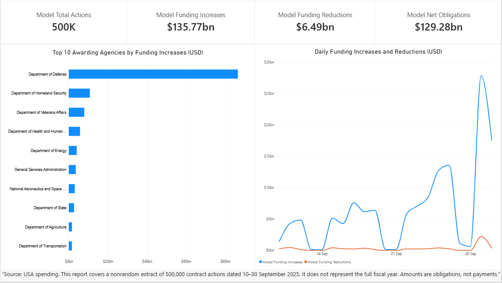
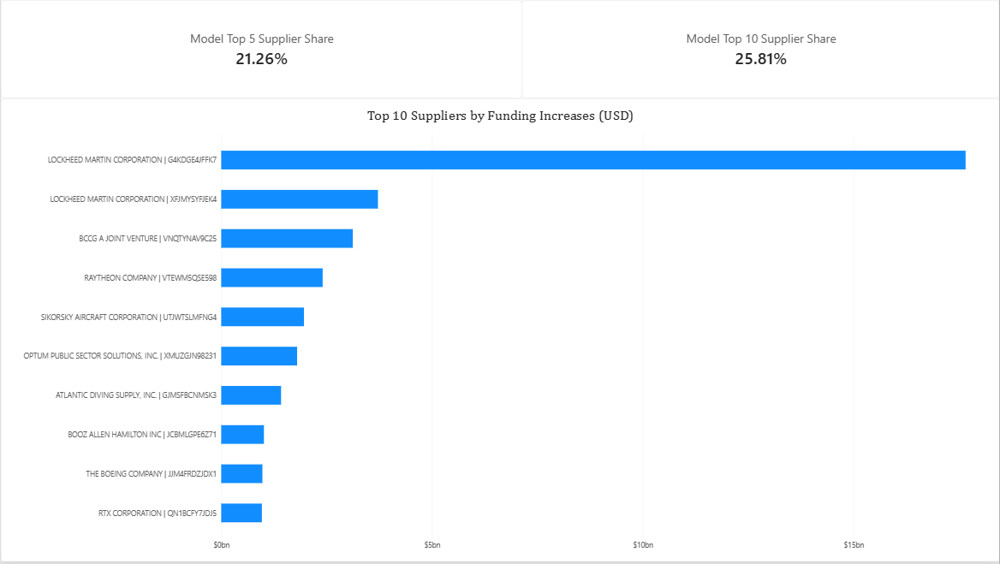
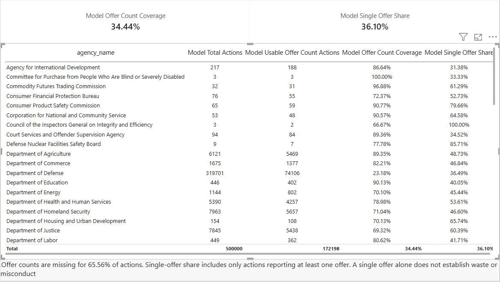

# Procurement Analytics Engineering

An ELT analytics project that transforms 500,000 public procurement contract actions into a tested star schema and a Power BI report. The project focuses on funding obligations, supplier concentration, agency activity, and the availability of competition data.

## Business question

How can a large set of contract actions be shaped into a reliable model that lets users examine funding changes, supplier concentration, agency activity, and reported offer counts?

## Project scope

- **Source:** USAspending contract action data
- **Extract size:** 500,000 actions
- **Observed action dates:** September 10–30, 2025
- **Warehouse:** Google BigQuery
- **Transformations:** SQL models managed with dbt, run from a local development environment
- **Analytics model:** one fact table and three dimensions
- **Reporting:** Power BI, with three report pages

This is a nonrandom extract covering 21 days. It is not a full fiscal-year or population-level view of federal procurement.

## Data model

The fact table has one row per procurement contract action. Dimension tables provide reusable descriptions for supplier, agency, and date analysis.

| Model | Role | Purpose |
|---|---|---|
| `fct_contract_actions` | Fact | Contract action amounts, offer-count data, and dimension keys |
| `dim_supplier` | Dimension | Supplier descriptions and supplier-level analysis |
| `dim_agency` | Dimension | Agency descriptions and agency-level analysis |
| `dim_date` | Dimension | Calendar attributes for time analysis |

Power BI uses single-direction, one-to-many relationships from the dimensions to the fact table. The report includes fact-based measures for increases, reductions, net obligations, supplier concentration, and offer-count metrics.

## dbt quality checks

The source includes **11 SQL models**, **9 singular SQL tests**, and generic key/relationship tests in `models/marts/marts.yml`. See [validation notes](docs/validation.md) for what has and has not been verified.

The project includes checks for expected record count and obligation-total reconciliation. Both were reported as passing for the 500,000-action model. These checks help detect lost or duplicated actions and changes to financial totals during transformation.

Offer-count missingness is retained as missing data rather than treated as zero. This distinction matters because an unreported offer count does not mean that no offers were received.

## Key results

| Metric | Result |
|---|---:|
| Contract actions | 500,000 |
| Distinct contracts observed | 483,055 |
| Identified suppliers | 36,836 |
| Funding increases | $135.77B |
| Funding reductions | $6.49B |
| Net obligations | $129.28B |
| Actions with usable offer counts | 172,198 (34.44%) |
| Single-offer share among actions with one or more reported offers | 36.10% |
| Top 5 supplier share of funding increases | 21.26% |
| Top 10 supplier share of funding increases | 25.81% |

Amounts are obligations, not payments. Offer-count results describe only records with usable reported offer counts; 65.56% of actions have no usable offer count in this extract. Supplier concentration ranks identified suppliers by funding increases. Its denominator includes all funding increases, including those attributed to unknown suppliers.

## Power BI report

The included improved Power BI project has three pages. The screenshots below show the earlier report layout, not fresh renders of this improved version:

1. **Procurement Overview** — action and obligation totals, agency funding increases, and daily funding changes.
2. **Supplier Analysis** — supplier-level funding and top-supplier concentration.
3. **Competition & Data Quality** — offer-count coverage and single-offer metrics by agency.

### Procurement Overview



### Supplier Analysis



### Competition & Data Quality



## Findings and implications

1. **Reductions materially affect the funding picture.** $135.77B of increases and $6.49B of reductions produce $129.28B of net obligations. Show all three measures together when reviewing funding activity.
2. **Funding is concentrated among a small number of identified suppliers.** The top five account for 21.26% of all funding increases; the top ten account for 25.81%. This supports further supplier-level review, without establishing excessive dependence or poor value.
3. **Competition analysis has limited coverage.** Only 34.44% of actions have usable offer counts. The 36.10% single-offer share applies to actions reporting at least one offer, not all 500,000 actions. Investigate reporting coverage before comparing agency competition metrics.

## Reproducing the project

This is an **ELT** project: source records are loaded into BigQuery first; dbt transforms them inside BigQuery. Local VS Code/dbt provides development and execution control.

### Requirements

- Python and `dbt-bigquery` compatible with the installed dbt version.
- A Google Cloud project with BigQuery access and an authenticated identity permitted to read the raw table, run query jobs, and write the output dataset.
- The original USAspending extract loaded to BigQuery, with its column names preserved and raw columns stored as **STRING**. The staging model applies `TRIM` and converts empty strings to null; the intermediate model casts dates and numeric measures.

The raw data, ingestion script, and original Python dependency lock were not supplied. This repository supplies transformation code, a Power BI project with its report and semantic model, and dashboard screenshots. The imported Power BI data cache is excluded. Exact extraction filters/order were not supplied; downloading the same date range alone may not reproduce this nonrandom 500,000-row extract.

### Setup

1. Install the adapter in a Python virtual environment:

   ```bash
   python -m pip install dbt-bigquery
   ```

   The original dependency versions were not supplied. Record the versions from a successful run before introducing a version lock.

2. Copy `profiles.yml.example` to your local dbt profiles directory as `profiles.yml`. Replace the project, dataset, and location placeholders; authenticate for BigQuery using your own account. Keep the real profile outside version control.
3. In `models/staging/sources.yml`, set `database` to your source Google Cloud project ID. The supplied source declaration uses the original project ID, dataset `procurement_raw`, and table `contract_actions`.
4. Ensure the raw table exists. The original extract has 500,000 rows; two supplied tests assert that specific size. For a different extract, deliberately update those expectations and revalidate all results.
5. From the repository root, run:

   ```bash
   dbt debug
   dbt build
   dbt docs generate
   ```

   No external dbt package references were found in the supplied code; there is no `packages.yml` in the archive.

6. Open `powerbi/Procurement_Funding_Improved.pbip` in Power BI Desktop. Update the four source queries to your BigQuery project and output dataset, authenticate, and refresh. Keep the report and semantic-model folders beside the `.pbip` file. See `powerbi/START_HERE.txt`. Native opening and refresh have not been tested during packaging.

See [architecture and metrics](docs/architecture-and-metrics.md) for relationship settings and metric definitions.

## Repository contents

| Path | Contents |
|---|---|
| `dbt_project.yml` | Project name, profile name, model path, default materialization |
| `models/staging/` | Source declaration and whitespace/null normalization |
| `models/intermediate/` | Type conversion and funding/quality flags |
| `models/marts/` | One fact, three dimensions, and generic tests |
| `models/reporting/` | Five SQL reporting summaries |
| `tests/` | Nine reconciliation and quality tests |
| `docs/` | Architecture, metric definitions, validation notes, and screenshots |
| `powerbi/` | Improved report, semantic model, nine DAX measures, and opening instructions; no data cache |
| `profiles.yml.example` | Credential-free BigQuery profile example |
| `.gitignore` | Exclusions for local configuration, generated output, and large files |

The original models and tests are preserved. SQL reporting summaries remain useful for reconciliation even though Power BI uses fact-based measures.

## Limitations

- The data covers only September 10–30, 2025 and is a nonrandom extract.
- Results should not be generalized to all federal procurement or an entire fiscal year.
- Obligations are not the same as cash payments.
- Offer counts are missing for most actions, which limits competition analysis.
- Funding concentration and offer-count metrics are descriptive. They do not establish waste, poor performance, or misconduct.

## Tools

- Google BigQuery, SQL, and dbt
- VS Code
- Power BI
- USAspending contract action data
