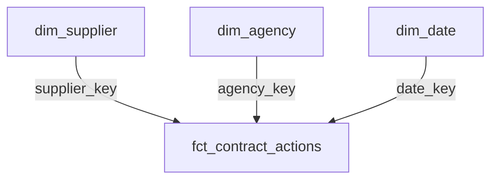

# Architecture and metric definitions

## Transformation layers

The raw BigQuery table feeds `stg_contract_actions`, which normalizes whitespace and empty strings. `int_contract_actions` preserves raw values and uses safe casts for dates, obligations, and offer counts. The mart layer builds supplier, agency, and date dimensions plus the action-level fact. Six reporting views aggregate the fact for SQL analysis and reconciliation. Power BI uses the fact and dimensions directly.

The supplied source expects STRING columns. A missing offer value becomes null, a failed numeric cast is flagged as invalid, and a negative offer count is separately counted in the overview. Unknown supplier/agency identifiers map to explicit `unknown` dimension rows.

## Star schema

| Dimension key | Fact key | Power BI setting |
|---|---|---|
| `dim_supplier.supplier_key` | `supplier_key` | Active, one-to-many, single direction |
| `dim_agency.agency_key` | `agency_key` | Active awarding-agency relationship, one-to-many, single direction |
| `dim_date.date_key` | `date_key` | Active, one-to-many, single direction |
| `dim_agency.agency_key` | `funding_agency_key` | Optional inactive relationship for separate funding-agency measures |

One fact row is one contract action. A contract can have multiple actions; contract counts and action counts therefore answer different questions. Dimension names are selected from the latest observed action for an identifier. These are current descriptions within this extract, not slowly changing dimensions preserving historical labels.

## Metrics

| Metric | Definition |
|---|---|
| Total actions | Fact row count |
| Funding increases | Sum of obligation amounts greater than zero |
| Funding reductions | Negative of the sum of obligation amounts below zero; displayed as a positive magnitude |
| Net obligations | Sum of signed obligation amounts |
| Identified suppliers | Distinct supplier keys excluding `unknown` |
| Offer-count coverage | Actions with a non-null, nonnegative offer count / all actions |
| Single-offer share | Actions with exactly one offer / actions with at least one offer |
| Top-N supplier share | Funding increases of the N highest-ranked identified suppliers / all funding increases, including unknown suppliers |

Supplier ranking uses a unique supplier key to break ties. Report chart labels combine supplier name and UEI so separate identifiers sharing a name do not merge. Parent-company rollups are not implemented. The Power BI concentration measures ignore supplier selections while retaining date and agency filters.

`rpt_agency_summary` contains awarding and funding roles. Filter/group by role before interpreting totals: summing both roles together counts each action twice.

## Interpretation boundaries

Obligations are commitments, not cash payments. Funding reductions are not automatically savings. One reported offer does not establish misconduct or absence of competition. Missing offer counts are not zero offers. Daily movements describe this extract and do not establish seasonality or forecasting performance.

## Prescriptive review queue

The additional dbt view `rpt_procurement_review_queue` uses contract facts and awarding-agency labels to suggest **targeted next reviews**. It provides evidence metrics, minimum sample conditions, analyst actions, and interpretation warnings for offer-count completeness, single-offer proportions, supplier concentration, and funding changes. It does not change the existing fact/dimensions or the three-page Power BI report. See [prescriptive methodology](prescriptive-analysis.md). This extension has not yet been executed against a live warehouse.
